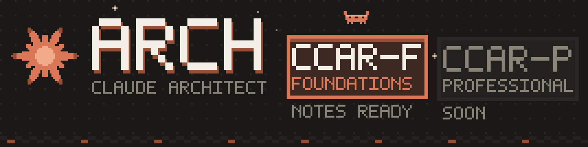

<div align="center">



<br>


**Study notes and practice exams for the Claude Certified Architect certification.**

[Choose your track](#choose-your-track) · [Study path](#study-path) · [Courses covered](#courses-covered) · [Roadmap](#roadmap) · [Repo map](#repo-map)


</div>

> **Work in progress.** The CCAR-F notes and practice sets are here now. The timed mock-exam website and CCAR-P material come after the updated exam guide is published on 17 December.

## Choose your track

| | **CCAR-F**: Foundations | **CCAR-P**: Professional |
|---|---|---|
| **Status** | Notes and practice sets ready | Planned |
| **What's here** | Notes for all 10 Architect courses, commute cards, 4 practice sets | Nothing yet, waiting on the new exam guide |
| **Start with** | [`00-platform-model-foundations-notes.md`](00-platform-model-foundations-notes.md) | See the [roadmap](#roadmap) |

## Study path

For CCAR-F. Each step feeds the next.

| Step | Do this | Why |
|:-:|---|---|
| **1** | Read the foundations notes ([`00`](00-platform-model-foundations-notes.md)) | The four decisions behind every session: entry point, capability layer, model, context |
| **2** | Read the full notes ([`01`](01-full-study-notes.md)) | All ten courses, each with must-remember facts, syntax, debug priority and trade-offs |
| **3** | Reread the recall cards daily ([`02`](02-commute-recall.md)) | Short, phone-friendly blocks: one per stop |
| **4** | Take Sets A and B | 32 questions each, course-style: "it worked in dev, broke in prod; pick the targeted fix" |
| **5** | Take Sets C and D | 30 questions each, certification-style: BEST/FIRST/NOT, choose-two and ordering items |

Two ideas repeat across the whole path:
- **Technically:** put the right thing in the right layer (prompt vs Skill vs hook vs tool vs MCP vs subagent; proxy vs gateway; Enterprise vs cloud path).
- **In delivery:** decide and measure before Day 1: path, gap memo, baseline, champion.

## Courses covered

Notes follow the ten courses on the Skilljar **Claude Architect** learning path. Every section uses the same layout: **must remember**, **syntax**, **debug priority**, **trade-offs and fixes**.

| # | Course | Focus |
|:-:|---|---|
| C1 | AI Capabilities and Limitations | Four machine properties and how they collide |
| C2 | AI Fluency for Builders | The 4D Framework applied to building products |
| C3 | Claude Platform & Model Foundations | Entry point, capability layer, model, context |
| C4 | Claude Platform 101 | Messages API, agent loop, tools, thinking, skills, MCP, managed agents |
| C5 | Claude Code 101 | Loop, permissions, workflow, context, CLAUDE.md, subagents, MCP, hooks |
| C6 | Introduction to Model Context Protocol | Building MCP servers and clients in Python |
| C7 | Introduction to subagents | Creating, designing and choosing subagents |
| C8 | Product Foundations | What Claude Code is, model selection, the seven platform paths |
| C9 | Deployment Architecture | Path decision, parity gaps, proxy, LLM gateway, ZDR and residency |
| C10 | Delivery Methodology | Qualification, pilot design, ROI, adoption curve, champions, 30-day activation |

<details>
<summary><b>Known gaps in the notes</b></summary>

- Lesson **videos** in C1, C2, C4, C5 and C7 were not transcribed; the written lesson text was captured in full.
- C6 lesson videos failed to load; the written summaries were captured.
- End-of-course quizzes were not attempted.
- Course code was checked against the `claude-api` skill (cached 2026-10-06). Where the shape has since changed, the note says so under **API drift** at the end of the full notes.

</details>

## Roadmap

- [x] CCAR-F notes for all ten courses
- [x] Commute recall cards
- [x] Practice Sets A–D with answers and reasoning
- [ ] Review everything against the new exam guide (17 December)
- [ ] Timed mock-exam website, as in the [Developer pack](https://github.com/aimanamri/claude-dev-exam-prep)
- [ ] CCAR-P notes and practice sets

## Repo map

```text
.
├── 00-platform-model-foundations-notes.md   the foundational course (C3)
├── 01-full-study-notes.md                   all ten courses
├── 02-commute-recall.md                     recall cards
├── 03-practice-exams.md                     Sets A–D with answers and reasoning
├── assets/                                  README pixel art and the script that generates it
└── Architect Exam Prep.md                   Obsidian index note
```

The notes are Obsidian-flavoured markdown (`[[wikilinks]]`) but read fine anywhere.

## Disclaimer

Unofficial study material, written from the course modules for personal exam preparation. Confirm version-specific details (model IDs, prices, limits, beta headers) at [platform.claude.com](https://platform.claude.com) before relying on them.

<div align="center">
<sub>Pixel art in <code>assets/</code> is generated by <a href="assets/make_art.py"><code>make_art.py</code></a>.</sub>
</div>
